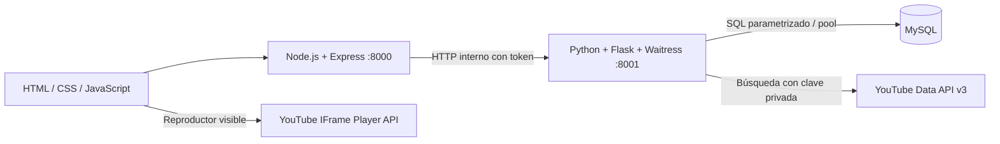
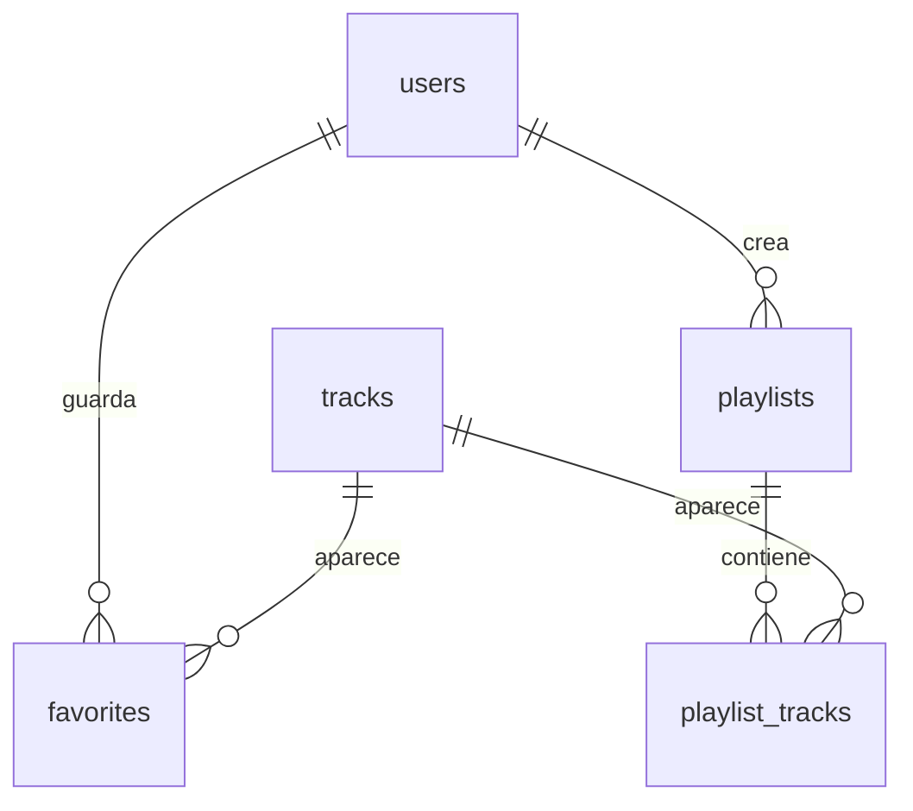

# Arquitectura y decisiones

## Responsabilidades

Express sirve la interfaz y aplica límites de peticiones. Inicia Python con un token aleatorio compartido en memoria y remite las solicitudes `/api`. Python contiene la lógica de negocio, firma las cookies de sesión, comprueba CSRF y permisos, consulta MySQL y realiza búsquedas de YouTube. Así se usan tanto Node.js/Express de la propuesta como Python solicitado por el equipo sin duplicar la lógica de negocio.

Waitress ofrece un servidor HTTP con varios hilos para Python; el conector SQL mantiene un pool de cinco conexiones. Las solicitudes a YouTube tienen un tiempo límite. La cola y los controles usan la API oficial del reproductor y sus eventos de estado.

## Modelo de datos

Los favoritos y las playlists pertenecen a una cuenta. Toda operación sobre una playlist comprueba al propietario. El catálogo de canciones es compartido; los resultados de búsqueda se guardan al añadirlos a una biblioteca. El administrador puede añadir y editar metadatos, y ocultar entradas del catálogo. Las claves foráneas impiden relaciones huérfanas.

## API

| Método | Ruta | Acceso |
| --- | --- | --- |
| GET | `/api/health` | Comprobación de Python y SQL |
| GET | `/api/session` | Sesión actual y token CSRF |
| POST | `/api/register`, `/api/login`, `/api/logout` | Gestión de cuenta |
| GET | `/api/library` | Catálogo y biblioteca del usuario actual |
| GET | `/api/search?q=...` | Búsqueda musical |
| POST | `/api/favorites` | Usuario autenticado |
| POST | `/api/playlists` | Usuario autenticado |
| GET | `/api/playlists/<id>` | Propietario |
| POST | `/api/playlists/<id>/tracks` | Propietario; `remove: true` elimina la relación |
| GET | `/api/admin` | Administrador |
| POST | `/api/admin/tracks`, `/api/admin/visibility` | Administrador |

Las solicitudes de escritura incluyen `X-CSRF-Token`. Express añade `X-Internal-Token` antes de llamar a Python; el navegador nunca recibe ese secreto. La cookie de sesión es HttpOnly y SameSite=Lax. En localhost se usa HTTP; un futuro despliegue requiere HTTPS y adaptar la validación de origen y la configuración de cookies.

## Evolución

1. Prototipo visual y API local Python/SQLite para explorar el flujo musical.
2. Incorporación de la propuesta del equipo: cambio a MySQL y adición de Node.js/Express.
3. Registro, sesiones, autorización, biblioteca individual y administración.
4. Pruebas SQL de integración, comprobación de la pasarela Express y CI con MySQL.

No se incluyen credenciales ni datos locales en Git. La variante inicial SQLite no forma parte del runtime final.
